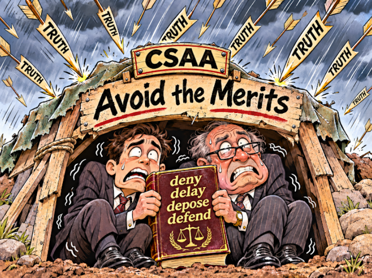

# Personal dialogue: November 17, 2026, 1:13 p.m. LOOK WHO REWROTE HISTORY!

> **Class: personal dialogue.**
>
> This document is my **personal dialogue** and public commentary. It is my speech.
>
> It is protected expression under the **First Amendment** to the United States Constitution and **article I, section 2** of the California Constitution. I am commenting on public court proceedings, insurance claim-handling, and the conduct of litigation in which I am a party. That is speech on a matter of public concern. It is not converted into a pleading by being addressed to counsel, posted on a public docket-mirror, or disliked by the people it describes.
>
> **This is not a court filing.**
>
> **Formal positions stay in the file.** Positions I direct to CSAA Insurance Exchange, to any other party, or to any tribunal remain solely those stated in papers already on file in CGC-25-631801, CGC-25-631802, A173827, CGC-21-594102, C26-02801, and Supreme Court No. S299144.
>
> Publishing this page is not service. This page is not a filing. It does not restart any Code of Civil Procedure section 128.7 clock.
>
> Face banners: [personal dialogue](../correspondence/banners/personal-dialogue.md) · [reservation of rights](../correspondence/banners/reservation-of-rights.md).

## Archive wrapper

| Field | Value |
|-------|-------|
| Date sent | November 17, 2026, 1:13 p.m. Pacific |
| From | soltrinox@gmail.com |
| To | rebekah.morrissey@csaa.com; julie.reece@csaa.com; erika.garnica@csaa.com; alreyna@psalaw.net; pnavaratnasingham@psalaw.net; soltrinox+legal@gmail.com; toconnell@porterscott.com; ctapp@porterscott.com; areyna@psalaw.net |
| Subject | COMMENTARY ❗️ LOOK WHO REWROTE HISTORY! ❗️ |
| Class | Personal dialogue |
| Sent status | Sent. Gmail print PDF archived with this page. |
| Court-seen theory | Chronology reorder, omitted 11 RT 4:11-14 qualification, CACI-number swap, and objection expansion into consent already named in the corrected petition, the filed overlength reply, and [DEFENSE.FAILURE.md](../DEFENSE.FAILURE.md). |
| Source print | [Gmail print PDF](Gmail%20-%20COMMENTARY%20❗️LOOK%20WHO%20REWROTE%20HISTORY!%20❗️.pdf) |

A later personal redistrib of the same commentary (November 17, 2026, 1:22 p.m.) is not republished here. Personal recipients are omitted.

## Attachments already on this site

- [Clerk letter, November 16, 2026 (S299144)](../01-APPEAL/s299144-supreme-court/07-clerk-letter-2026-11-16.pdf) (sent as `S299144_Letter_11.16.26.pdf`)
- [Overlength reply, filed November 16, 2026](../01-APPEAL/s299144-supreme-court/06-reply-to-answer-filed-2026-11-16.pdf) (sent as `S299144_MASTER_SIGNED_2026-11-16.pdf`)

## Commentary visuals (cropped from the sent Gmail print)

> **Commentary visuals; not a filing; not a court finding.** The cartoons label cherry-picking, record stitching, and avoiding the merits. The prose accusation, with pins, is in [DEFENSE.FAILURE.md](../DEFENSE.FAILURE.md) and in the sent text below.

## Sent text

LOOK WHO REWROTE HISTORY!

A Personal COMMENTARY Letter to the Entire Defense Team

To the Entire Defense Team,

Well, well, well. Look who was actually rewriting history. I find it almost comically ironic that your team had the audacity to accuse me, not once but twice, of "rewriting history," while your own appellate pleadings reveal exactly who was rearranging the historical record. You took my statements out of chronological order, moved earlier remarks behind later ones, omitted my immediate qualification, and stitched the remaining fragments together to manufacture a story of waiver. Then you presented that patchwork to the Court of Appeal and recycled it in your Answer to the California Supreme Court. Cherry-picking, record-stitching, quote laundering, and rewriting the record. Quite an impressive collection of techniques for a team accusing someone else of manipulating history. Unfortunately for your narrative, the certified transcript has not learned to rearrange itself.

What makes this particularly entertaining is that every time someone on your team makes an accusation, all I have to do is examine your exact words to discover what you are telling me about your own argument. Remember when Priya insisted there was no evidence of prejudice from the court's response? (11 RT 5:15-19.) That declaration did not resolve the question of prejudice; it merely announced the defense's preferred conclusion. Now you accuse me of rewriting history, and what happens when I examine your own words? I discover the same reversed sequence in two appellate filings, the same conveniently omitted qualification, and the same effort to transform my objections into consent. At this point, your pleadings are practically doing my work for me. You keep making accusations, and your own documents keep supplying the contradictions.

REWRITING THE RECORD: Your team apparently decided that ordinary chronology was an unnecessary inconvenience. My earlier acknowledgment at 11 RT 4:8-10 was placed after the later exchange at 11 RT 4:15-25 and introduced with "Further on," creating the appearance of subsequent confirmation that does not exist in that order in the transcript. Both filings cited 11 RT 4:8-14 while omitting my immediately adjoining qualification at lines 11-14. My objection to jurors accessing outside legal information became supposed approval of the judge withholding instructions. My objections concerning the enhanced vehicle definition were folded into your claim that I opposed the turning-duty law. And the judge's express acknowledgment and overruling of my objections to both completed responses (11 RT 11:28-12:4; 12:27-13:7) somehow failed to disturb your sweeping consent narrative. Apparently, you can turn an objection into an agreement, move a statement backward through time, and call the resulting Frankenstein chronology invited error. What a masterpiece of selective quotation.

And while everyone was busy stitching together waiver, the jury had expressly requested instructions concerning Vehicle Code sections 22107 and 21804(a), raising the court's independent supplemental-instruction duty under Code of Civil Procedure section 614. Your response was to emphasize whether I had previously requested the correct CACI number. How wonderfully convenient. When the jury asks the judge for the law, blame the plaintiff's paperwork. When I object, call it agreement. When the judge overrules my objections, continue claiming consent. When I challenge your interpretation, accuse me of rewriting history. It is a remarkably elaborate strategy for avoiding the merits. If your legal positions are as strong as you claim, why does this entire defense team seem so determined to prevent a substantive examination of the underlying issues?

Now, Rebekah, let's discuss something considerably less entertaining: your professional obligations to the courts. There is a substantial difference between advocating a disputed interpretation of the transcript and knowingly or recklessly presenting material misrepresentations. Your repeated treatment of the certified record raises questions that deserve examination under California's professional-conduct rules. Since your team appears to have developed such a creative approach to chronological accuracy, I thought it appropriate to provide a brief refresher on the governing standards:

1. California Rule of Professional Conduct 3.3(a)(1), Candor Toward the Tribunal: Prohibits knowingly making false statements of fact or law to a tribunal or failing to correct previously made material false statements. Repeatedly advancing a materially misleading account of the transcript to establish waiver raises questions under this rule.

2. California Rule of Professional Conduct 8.4(c), Professional Misconduct: Prohibits dishonesty, fraud, deceit, and reckless or intentional misrepresentation. Selective quotation, omitted qualifications, and reordered statements used to create a materially misleading factual impression can implicate this provision.

3. Business and Professions Code § 6068(d): Requires attorneys to employ means consistent with truth and prohibits seeking to mislead a judge through artifice or false statements of fact or law. A materially inaccurate account of trial proceedings submitted to secure a favorable appellate disposition warrants serious scrutiny.

4. Business and Professions Code § 6106: Provides grounds for discipline involving moral turpitude, dishonesty, or corruption. Proven serious dishonesty in judicial proceedings can result in substantial professional consequences, including suspension or disbarment.

So here are the questions your own pleadings raise, Rebekah. [1] Did you know the actual chronological sequence when you prepared and signed those documents? [2] Why did both filings cite 11 RT 4:8-14 while omitting the qualification within that very range? [3] Why did the earlier statement appear after the later exchange under the words "Further on"? [4] Why was the same presentation repeated before the Supreme Court after the record interpretation had already been challenged? [5] And why was the trial judge's final acknowledgment and overruling of my objections not reconciled with your categorical claims of consent?

These are not questions that disappear simply because you prefer your interpretation. They are questions your own signed pleadings have created.

[REDACTED - forthcoming instrument; not a description of the withheld words] I will leave findings concerning knowledge, intent, and professional misconduct to the appropriate authorities. I do not need to invent motives when I can place your appellate brief, your Supreme Court Answer, and the certified transcript side by side. You supplied the quotations, the pin cites, and the contradictions. All I had to do was put the statements back in their actual order. And as you may have noticed, the Supreme Court accepted my extended reply, placing these issues before the court. That acceptance is not a decision on the merits, but the discrepancies are now expressly identified in the filing.

Meanwhile, I suggest the rest of you pay attention, because [REDACTED - forthcoming instrument; not a description of the withheld words] Thanks to Tyler and Chad, I believe the filings and admissions already made have provided substantial grounds to examine CSAA's conduct in Superior Court. [REDACTED - forthcoming instrument; not a description of the withheld words] Tyler has also attempted to characterize my litigation responses as vexatious, and [REDACTED - forthcoming instrument; not a description of the withheld words] Go figure: apparently, responding to your arguments is vexatious, while repeatedly moving my statements around the transcript is just excellent advocacy. I suppose that is one way to define fairness.

Every one of you has been given multiple opportunities to resolve this matter. Yet you apparently continue to believe I will abandon my pursuit of the merits rather than challenge what I regard as serious misconduct and improper claims handling. [REDACTED - forthcoming instrument; not a description of the withheld words] I suspect an examination of those records will be considerably less entertaining for CSAA than the invoices your firms have been sending it.

And let's discuss those invoices. I know you are well aware that I am indigent and carrying hundreds of thousands of dollars in medical debt arising from this incident. CSAA has maintained its zero-dollar disposition for approximately five years despite the evidence I contend undermines that determination. Go ahead and continue pursuing attorney fees if you believe that financial pressure will discourage me from seeking lawful adjudication. [REDACTED - forthcoming instrument; not a description of the withheld words] You cannot squeeze blood from a turnip, and you certainly cannot frighten someone into silence by threatening financial consequences when that person is already facing overwhelming financial losses.

CSAA had an opportunity to resolve this matter in 2023. Instead, the dispute has developed into years of litigation and what I contend is multimillion-dollar exposure. I remain willing to evaluate a serious settlement proposal on its merits. [REDACTED - forthcoming instrument; not a description of the withheld words] Your decision to keep litigating does not make the underlying questions disappear, and billing more hours does not make the certified transcript say something different.

I've also included, for your personal records, confirmation of the Supreme Court's acceptance of my extended reply to the defense's answer. You might want to frame it and put it on the wall. I have shared my commentary publicly because I believe the conduct documented in these proceedings deserves scrutiny. You may find that commentary distasteful. I find the conduct I am describing considerably more distasteful. And if you wonder why I continue sending these commentaries, the answer is simple: I'm not writing them for your enjoyment. I'm writing them because I find the process cathartic, and because I intend to preserve an accurate account of what has occurred.

So here is my message to every attorney who prepared, reviewed, approved, or defended these pleadings: the party whose filings demonstrably rearranged the sequence of the recorded exchange was the defense. Repetition alone does not establish deliberate deception, but it makes the repeated discrepancies impossible to dismiss as something appearing in only one document. I intend to expose those discrepancies through your own citations, your own quotations, and the certified transcript. Every material comparison can be independently examined.

And now we return to the most delicious irony of all.

You accused me of rewriting history. Twice.

I was like what the hell is this hack accusing me of? I had to go and look , surprise, surprise, Rebekah. Look who got caught rearranging the story. People always tell on themselves.

Next time, before accusing me of something, you might want to look in the mirror and read your own pleadings first. They have an extraordinary habit of telling on you. You can call it advocacy. I call it cherry-picking, record-stitching, and an attempt to manufacture waiver through a materially disputed presentation of the record.

The transcript is not your personal scrapbook. Chronology is not optional. And a pin cite does not magically turn a misleading narrative into the truth.

Enjoy,

Franciscus Dylan Rosario
Your favorite Vexatious Litigant

---

Object assignment locked for the jury-facing objection described above: He objected to the trial judge's failure to instruct the jury before deliberations, which, in his understanding, left jurors needing to seek legal guidance concerning the evidence. His objection to that resulting predicament is not an objection to supplying the instructions, and it is not consent to refusing them.

[DEFENSE.FAILURE.md](../DEFENSE.FAILURE.md) · [Consequence registry](CONSEQUENCE-REGISTRY.md) · [S299144 hub](../01-APPEAL/s299144-supreme-court/README.md) · [Commentary index](README.md) · [Site root](../README.md)
