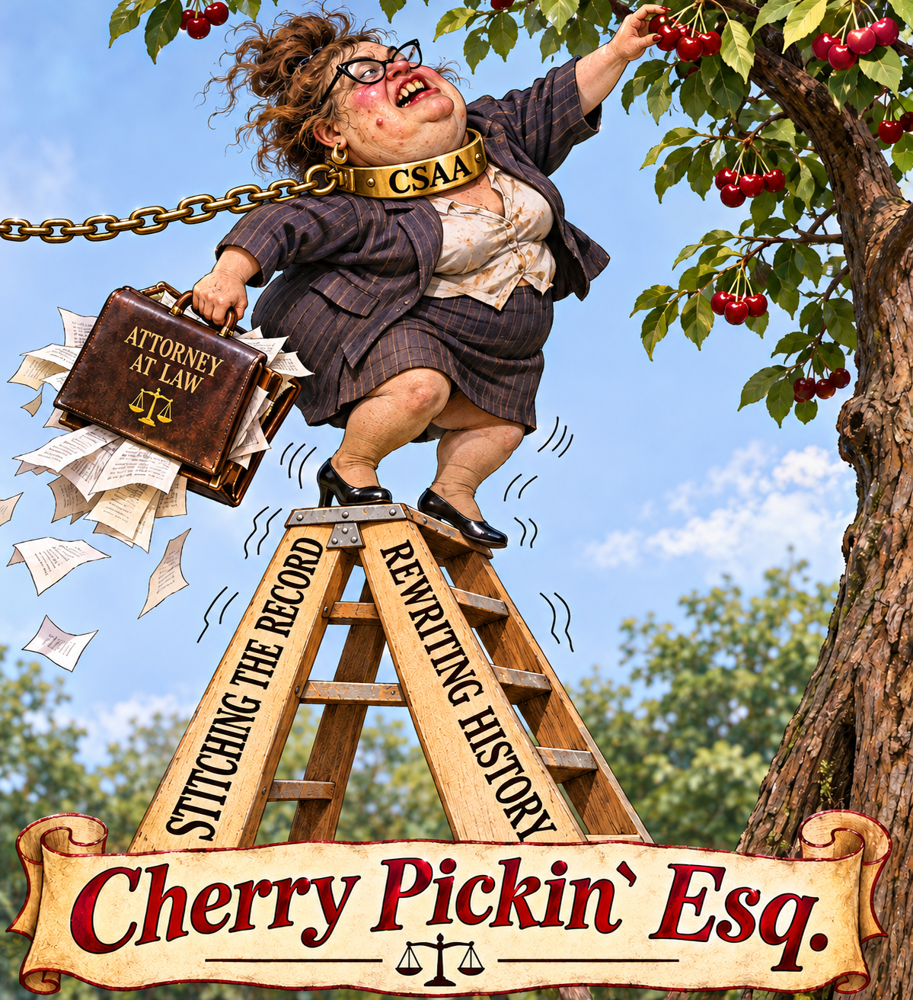

## Supreme Court No. S299144

Rosario asks the Supreme Court three questions in the corrected petition. The first is whether an agreement about an original proposed jury response is consent to a materially modified completed response sent to the jury without prior review and an opportunity to object. The second is whether his objection to suspected juror access to uninstructed law, and his mistrial motion, are consent to or inducement of the trial court's separate refusal to provide the statutory instructions the jury requested. The third is whether earlier review of proposed responses satisfies Code of Civil Procedure section 614 when the judge later adds material wording and transmits the completed responses without notice of the revised content before delivery.

His account is that the court omitted Vehicle Code sections 22107 and 21804(a) from the charge, instructed on general negligence and section 21651(b), and never furnished the promised completed charge. Jury Request No. 1 then asked whether, in considering the defendant's negligence, the jury should consider those two sections and, if so, could be instructed on them. He objected to the trial judge's failure to instruct the jury before deliberations, which, in his understanding, left jurors needing to seek legal guidance concerning the evidence. His objection to that resulting predicament is not an objection to supplying the instructions, and it is not consent to refusing them. He states that the completed replies contained two additions he and his assisting team had not been shown: a refusal to instruct in Reply No. 1, and a highway and street explanation added to Reply No. 2 and sent to the jury. He maintains that section 614 required notice of that revised content before delivery, and that the Court of Appeal treated his mistrial motion, the word "immaterial," and his discussion of an earlier formulation as agreement to the completed refusal.

The application and corrected petition stating that account were served on October 19, 2026, in Supreme Court No. S299144. A TrueFiling notice states that the Supreme Court filed S299144-corrected-petition-signed on October 19, 2026, at 11:55 p.m., as a petition for review (fee previously paid). By order filed October 20, 2026, the Court granted permission to substitute that corrected petition. The corrected petition is the operative petition for review.

Respondent's answer to the petition was received November 10, 2026. The Supreme Court clerk letter of November 16, 2026 states that permission was granted to file a reply in excess of 4,200 words, that reply was filed that date, and permission to file a supplemental memorandum in support of the petition was denied.

Hub of court papers (petition, Oct. 20 order, Answer, opinion, overlength application, filed reply, clerk letter): [01-APPEAL/s299144-supreme-court/](01-APPEAL/s299144-supreme-court/README.md)

[Application and corrected petition, served October 19, 2026 (PDF)](01-APPEAL/S299144-application-substitute-corrected-petition-served-2026-10-19.pdf)

Posting this page is not service and does not restart any Code of Civil Procedure section 128.7 period.

[Sent commentary, October 20, 2026, 11:46 a.m.](COMMENTARY/2026-10-20-s299144-filing-accepted-commentary.md)

[Four-stage record guide (commentary), November 17, 2026](COMMENTARY/2026-11-17-s299144-four-stage-record-guide.md)

**Defense failure commentary (November 17, 2026).** Face-labeled commentary; not a filing. [DEFENSE.FAILURE.md](DEFENSE.FAILURE.md) names four acts in the Respondent's Brief and Answer: reorder 11 RT chronology; omit 11 RT 4:11-14; swap CACI numbers for a section 614 duty; expand objections into consent to Refusal 1. Those acts left instructional correctness and *Soule* prejudice untested on the [S299144 hub](01-APPEAL/s299144-supreme-court/README.md). Registry: [Oppose](COMMENTARY/CONSEQUENCE-REGISTRY.md#jury-prohibition).

> **Commentary visual; not a filing; not a court finding.** The cartoon labels cherry-picking and record stitching. The prose accusation, with pins, is in [DEFENSE.FAILURE.md](DEFENSE.FAILURE.md): chronology reorder, omitted qualification, CACI-number swap, objection expansion into consent.

---

**Notice charge versus discretion (commentary, October 18, 2026; shortened November 17).** Face-labeled commentary; not a filing. [Notice charge versus discretion: Reply No. 2 and section 614](COMMENTARY/2026-10-18-judicial-discretion-fourteenth-amendment.md) states the section 614 notice charge for the Reply No. 2 enhancement and why discretion, a correct statutory quote, and a no-prejudice claim do not meet that charge. Pins stay on Rosario's account and 11 RT.

---

# Rosario v. Abdelhalim et al.: what the defense papers did

> Open public record. All documents are California court filings.

> **Speech and petition (governing).** This archive is published as speech. The lawsuits are filed as petitions. Those are two different rights. The homepage states them in full under [Speech, petition, and why this archive is public](#speech-petition-and-why-this-archive-is-public). Publishing a page here is not a filing, is not service, and does not restart any Code of Civil Procedure section 128.7 period.

This page states what filed defense papers did across four choices already named in the [consequence registry](COMMENTARY/CONSEQUENCE-REGISTRY.md): **Deny**, **Delay**, **Defend**, and **Oppose**. Each choice is tied to a paper a court has seen. The archive below keeps the case hubs, transcripts, and correspondence as filed or sent.

## Public Interest Notice

> **This section is commentary.** It is published as speech under the First Amendment to the United States Constitution and article I, section 2 of the California Constitution. It is not a court filing. It is not service of any paper on any party. It does not restart any Code of Civil Procedure section 128.7 period.

This entire record is of public interest. The reasons are stated in [Public Interest Notice](COMMENTARY/PUBLIC-INTEREST-NOTICE.md).

**Plaintiff:** Franciscus Dylan Rosario (in pro per)
**Forums:** San Francisco Superior Court; Contra Costa Superior Court; California Court of Appeal, First Appellate District
**Cases:** CGC-21-594102 (trial) · A173827 (appeal) · CGC-25-631801 / A177553 (equity, on appeal) · CGC-25-631802 / A177567 (denial-letter fraud, on appeal) · C26-02801 (common-law deceit)
**Last refresh:** November 17, 2026

## Contra Costa

## Banner argument: C26-02801 and the core wrong

> **This section is commentary published September 22, 2026.** It is not a court filing, is not service of any paper, and does not restart any Code of Civil Procedure section 128.7 period. The legal formulation was sent by email to CSAA and its counsel on September 22, 2026. The verified complaint is on file as Contra Costa Case No. C26-02801.

**The core wrong is independent common-law deceit about completed historical acts.** CSAA represented that it had "concluded our investigation" after "carefully reviewing the facts and circumstances." The filed complaint alleges that the claim file recorded no request, receipt, or review of the police-report-identified 911, body-worn-camera, and computer-aided-dispatch materials before closure. The action seeks reliance damages under Civil Code sections 1709, 1710, subdivision (1), and 3333. It does not seek private enforcement of Insurance Code section 790.03, policy benefits, or the value of the underlying bodily-injury claim.

*[Moradi-Shalal v. Fireman's Fund Insurance Companies](04-CASE-C26-02801/INDEX.md#the-preservation-clause)* (1988) 46 Cal.3d 287, 304-305 expressly preserves appropriate traditional common-law actions against insurers, including fraud, while barring an implied private cause of action under section 790.03.

**[Read the full legal argument and supporting record links.](04-CASE-C26-02801/INDEX.md)** The sent September 22, 2026 email is [here](correspondence/personal-dialogue/2026-09-22-contra-costa-moradi-shalal.md). The filed complaint PDF is [here](04-CASE-C26-02801/VERIFIED-COMPLAINT-C26-02801.pdf).

---

## San Francisco and appellate

## Ten defense acts

> **This section is commentary.** It is published as speech under the First Amendment to the United States Constitution and article I, section 2 of the California Constitution. It is not a court filing. It is not service of any paper on any party. It does not restart any Code of Civil Procedure section 128.7 period. Formal positions remain those stated in papers already on file.

These ten are the sharpest illegal acts in the defense chronology. Each one is already in the claim file, the reporter's transcript, or a paper a court has seen.

1. **The denial letter certified an investigation that was never done.** On February 25, 2021, CSAA claims representative Sarah Rash wrote that the insurer had "concluded our investigation" and that the insured was not liable. The file did not contain the driver's 911 call, the body-worn camera video, or the dispatch record. [015](DEFENSE-OFFENSE-CHRONOLOGY.md#015)
2. **The Answer accused the injured pedestrian of a DUI conviction he does not have.** On September 14, 2021, Michael R. Chambers filed a fifth affirmative defense alleging plaintiff was driving in violation of Vehicle Code sections 23152 or 23153 "for which violation(s) plaintiff was convicted," and used that allegation to cut non-economic damages. Plaintiff was the pedestrian. No such conviction exists. [023A](DEFENSE-OFFENSE-CHRONOLOGY.md#023A)
3. **A sworn motion told the trial court the confession tape had not been produced.** On January 17, 2025, Priya D. Navaratnasingham filed Motion in Limine No. 6 (transaction 80936030) representing that the recorded materials "were not produced in discovery." The defense file had held them since the August 18, 2022 deposition. [035](DEFENSE-OFFENSE-CHRONOLOGY.md#035)
4. **Confronted with sworn proof of that production, counsel told the judge it was "news to me."** On February 18, 2025, after Jeremy Jessup testified that the 911 audio, body-worn camera videos, and dispatch records were produced to defense counsel, Navaratnasingham said: "So this is news to me." The court answered: "I see. Okay." [040](DEFENSE-OFFENSE-CHRONOLOGY.md#040)
5. **Minutes after telling 911 he hit the man, the driver told the officer he felt no impact.** On the February 4, 2021 recording the driver said "BOOM! I just hit him." He then told Officer Fernandez he did not feel any impact, did not see the plaintiff, and that the van had no damage. The police report adopted that account and assigned fault to the injured party. [005](DEFENSE-OFFENSE-CHRONOLOGY.md#005)
6. **The driver left the injured person and later swore he never left.** He moved the van away. A passerby's 911 call reported "a hit and run ... nobody helping him." At deposition he said "I never left." The pleaded defect is the hit-and-run duty in Vehicle Code section 20001. [003](DEFENSE-OFFENSE-CHRONOLOGY.md#003)
7. **The admission that the defense had the videos came only after the exclusion rulings.** On April 16, 2025, trial day 7, counsel said the videos "were provided by Dolan" and described cutting five videos down to about eight or nine minutes. That concession came after the rulings the "unknown origin" motions had already procured. [050](DEFENSE-OFFENSE-CHRONOLOGY.md#050)
8. **The jury asked for the turning statutes by number and was told they were not evidence.** On April 23, 2025, the jury asked whether it could consider Vehicle Code sections 22107 and 21804. The court answered that neither section was part of the evidence: "They simply are not permitted to consider that as evidence in the case, period." The defense stood by, then accepted Vehicle Code definitions it had requested. The later appeal treated that refusal as the plaintiff's waiver. [062](DEFENSE-OFFENSE-CHRONOLOGY.md#062)
9. **The insurer's own anti-SLAPP brief admitted it never obtained the 911 call, the video, or the dispatch record, and still called the investigation complete.** The April 9, 2026 memorandum in CGC-25-631802 (transaction 79007560) concedes those materials were not obtained before the February 25, 2021 letter, and still describes the investigation as a review of the available evidence. [107](DEFENSE-OFFENSE-CHRONOLOGY.md#107)
10. **Counsel asked a trial court to gate every future filing in California and to brand the injured party vexatious for suing on the empty file.** The July 21, 2026 motion under Code of Civil Procedure section 391 sought judicial approval for any further filings in the State of California. The collision case was against the driver, it was on appeal, and there had been no finally determined action against CSAA on the claims-handling claim. [130](DEFENSE-OFFENSE-CHRONOLOGY.md#130)

**[Read the full list](DEFENSE-OFFENSE-CHRONOLOGY.md)**

### What follows from those acts

> **This block is commentary.** It restates consequences already assigned in papers on file. It is not a new filing and does not restart any Code of Civil Procedure section 128.7 period.

Four choices run through the ten acts: Deny, Delay, Defend, Oppose. Each already has a consequence in a paper a court has seen. Full table: [consequence registry](COMMENTARY/CONSEQUENCE-REGISTRY.md). Spine statement next.

## Deny, Delay, Defend, Oppose: the same four choices on one spine

> **This section is commentary.** It is published as speech under the First Amendment to the United States Constitution and article I, section 2 of the California Constitution. It is not a court filing. It is not service of any paper on any party. It does not restart any Code of Civil Procedure section 128.7 period. Formal positions remain those stated in papers already on file.

On February 4, 2021, a commercial driver struck Rosario from behind in a San Francisco crosswalk. The driver called 911, authenticated that call under oath at trial, and said he had hit the man. Officers wore cameras. Dispatch logged the collision. Rosario was admitted to the trauma ICU. Twenty days later, an unsolicited CSAA letter stated that an investigation had been performed and concluded and that the insured was not liable.

**Deny.** The February 25, 2021 letter certified a concluded investigation. The filed deceit complaint alleges the 911, body-worn-camera, and dispatch materials were not in the claim file before closure. Consequence assigned in filed papers: common-law deceit in C26-02801; negligent misrepresentation in CGC-25-631802. Registry: [Deny](COMMENTARY/CONSEQUENCE-REGISTRY.md).

**Delay.** January 17, 2025 declarations told the trial court the same materials were of unknown origin and had not been produced. February 18, 2025: counsel said the evidence was "news to me." April 16, 2025, after the exclusion rulings: "They were provided by Dolan." The next day the driver authenticated his voice on the 911 call. The deliberating jury asked for Vehicle Code sections 22107 and 21804; the court answered that those statutes were not evidence and would not be instructed. Verdict: 9 to 3. Consequence assigned: extrinsic-fraud equity action in CGC-25-631801; the verdict returned on that narrowed record. Registry: [Delay](COMMENTARY/CONSEQUENCE-REGISTRY.md).

**Defend.** April 9, 2026 anti-SLAPP papers treated the 2021 denial as protected petitioning in anticipation of litigation. The carrier's own papers describe an adversarial purpose during the claim window. Four results already stated in [Part 6](#part-6). Registry: [Defend](COMMENTARY/CONSEQUENCE-REGISTRY.md#privilege-choice).

**Oppose.** Respondent's brief treats the jury's request for those Vehicle Code sections as the plaintiff's waiver. The July 21, 2026 section 391 motion sought an access bar and fees on strike orders now on appeal. August 26, 2026 Department 302 face ruling: "Off calendar. Case stayed." On the April 23 colloquy, [DEFENSE.FAILURE.md](DEFENSE.FAILURE.md) records reordered chronology, omitted qualification, and object-reassignment already present in the Answer and Respondent's Brief. Registry: [Oppose](COMMENTARY/CONSEQUENCE-REGISTRY.md#jury-prohibition).

Human-shape commentary (no names): [WHAT-HAPPENS-TO-A-PERSON.md](WHAT-HAPPENS-TO-A-PERSON.md)

---

Five proceedings share that spine. Below, for each: the question presented, where the defense stood, and what the filed record shows.

---

## Speech, petition, and why this archive is public

> **This section is commentary.** It is published as speech under the First Amendment to the United States Constitution and article I, section 2 of the California Constitution. It is not a court filing. It is not service of any paper on any party. It does not restart any Code of Civil Procedure section 128.7 period. Formal positions remain those stated in papers already on file.

This site is a public record of court papers and of correspondence that was actually sent. It is also speech: a party's account of public court proceedings, insurance claim-handling, and litigation in which that party is a named plaintiff. The filings are petitions. The site is speech about what those filings show. Mixing the two is how a public record gets recast as misconduct.

The rights are already invoked in papers a court has seen. A self-represented claimant may publish this archive without converting it into a pleading.

### Notice of Constitutional Rights, Transparency, and Public Interest

> **This notice is commentary.** It is not a court filing, is not service of any paper on any party, and does not restart any Code of Civil Procedure section 128.7 period. It discusses only the filed, served, or actually-sent material identified below and does not state a position beyond the papers already on file.

**I. Speech.** The First Amendment and article I, section 2 protect speech about the public record. This commentary concerns the February 25, 2021 CSAA denial letter, which states that an investigation was performed and concluded, and the January 17, 2025 declarations supporting MIL Nos. 6 and 17, which address the 911 materials as unknown in origin or not in counsel's possession. Those filings and record materials are identified in Parts 1 and 2 below.

**II. Petition.** The First Amendment and article I, sections 3 and 16 protect petitioning through court papers and the right to jury trial. The filed access and fee papers, and the July 27, 2026 safe-harbor letter that invokes article I, sections 3 and 16, are the source materials for this point. Speech and petition are distinct rights. Neither may be misconstrued, mislabeled, or weaponized to restrict legal standing or access to a tribunal.

**III. Due process.** The Fourteenth Amendment and article I, section 7 protect due process, including access to the courts. The public discussion here does not adjudicate the denial letter, the declarations, or the access and fee papers. It identifies the filed or served positions already stated about those materials and preserves the distinction between a commentary page and a pleading.

**IV. Transparency and public interest.** The sent correspondence archive and the filed record permit public examination of the denial letter, the declarations, and the treatment of the 911, body-worn camera, and dispatch materials. Publishing those sources as commentary does not convert them into service or a new court submission. The reasons this entire record is of public interest are stated in [Public Interest Notice](COMMENTARY/PUBLIC-INTEREST-NOTICE.md).

### Speech

The **First Amendment** protects freedom of speech. **Article I, section 2** of the California Constitution does the same, and on its face it is at least as protective: every person may speak, write, and publish on all subjects, being responsible for the abuse of that right.

The subject matter is public: a collision on a public street; a licensed insurer's written certification that an investigation was concluded; sworn representations to a trial court about the same evidence; a later request that the speaker lose access to the courts rather than that the letter be explained. Court proceedings are public. Insurance claim-handling is regulated. Commentary on either one does not become a pleading because it is posted here.

Pages on this site that are **not** court papers say so on their face. The human narrative at [WHAT-HAPPENS-TO-A-PERSON.md](WHAT-HAPPENS-TO-A-PERSON.md) is commentary. Personal dialogue in the correspondence archive is commentary. This section is commentary. Face banners used throughout the archive: [personal dialogue](correspondence/banners/personal-dialogue.md) · [reservation of rights](correspondence/banners/reservation-of-rights.md).

### Petition

The **First Amendment** also protects the right to petition the government for a redress of grievances. **Article I, section 3** of the California Constitution protects the right of the people to instruct their representatives, petition government for redress, and assemble. **Article I, section 16** protects jury trial. Plaintiff's appearance in propria persona, and the July 27, 2026 safe-harbor letter on the defense access/fee papers, invoke article I, sections 3 and 16 on their face: [2026-07-27-1287-vexatious-802.md](correspondence/safe-harbor-1287/2026-07-27-1287-vexatious-802.md).

The petitions are the complaints, the oppositions, the notices of appeal, and the other papers already on file in CGC-21-594102, A173827, CGC-25-631801, and CGC-25-631802. Positions directed to a party or to a tribunal remain solely those stated in the file.

Speech about a case is not a filing in the case. Attaching a commentary page as an exhibit does not make it a filing by the speaker, and it does not erase the papers that state the positions.

### Due process, and the later request to close the courthouse

The **Fourteenth Amendment** and **article I, section 7** of the California Constitution protect due process, including access to the courts. Exercise of speech and petition cannot be used as the reason to deny that access, or as the reason to punish it.

After the 2021 denial-letter versus 2025 MIL-declaration contradiction, and after choosing anti-SLAPP on a 2021 claims letter, the defense asked a trial court for an access bar and fees on the strength of rulings now on appeal. That ask is an escape from merits adjudication. The rights already invoked in papers a court has seen remain: a self-represented claimant may speak about a public record, may petition a court on that record, and may exercise both without converting speech into the offense.

---

## The case in one page

On February 4, 2021 a pedestrian was struck in the crosswalk at Tehama and 5th Street in San Francisco. This site collects what the insurer wrote about that claim and what its lawyers later told courts about the same evidence.

Two writings sit at the center. A February 2021 denial letter says an investigation was performed and concluded. January 2025 declarations, signed under penalty of perjury by defense counsel, say the product of that investigation was not in counsel's possession and was of unknown origin. Both cannot be true on the face of the record.

Five proceedings ask different courts different questions about that contradiction.

| Proceeding | The question it asks | Posture |
|---|---|---|
| CGC-21-594102 | Was the pedestrian's injury caused by the driver's negligence? | Tried to verdict April 23, 2025; defense verdict 9 to 3 |
| A173827 | Did legal error in that trial require reversal? | Merits briefs complete August 20, 2026; respondent opposition to the companion motion to disregard received September 1, 2026; argument not set |
| CGC-25-631801 | Should the judgment be set aside because it was procured by extrinsic fraud? | Struck August 6, 2026; on appeal |
| CGC-25-631802 | Was the 2021 denial letter itself an actionable misrepresentation? | Struck July 1, 2026; on appeal |
| C26-02801 | Did CSAA commit common-law deceit by representing completed investigative acts that its claim file allegedly does not document? | Filed in Contra Costa Superior Court |

Alongside those proceedings, the defense filed a CCP 391 access motion seeking an access bar and fees on the strength of the strike orders now on appeal. On August 26, 2026, Department 302's court-sent face ruling stated "Off calendar. Case stayed." Citation map: [AUG26-COURT-POSTURE-AND-391-FINALITY.md](03-CASE-CGC-25-631802/vexatious-opposition-aug26-2026/AUG26-COURT-POSTURE-AND-391-FINALITY.md).

---

## Part 1. The contradiction

**Document one.** The [February 25, 2021 CSAA denial letter](MERITS-EXHIBITS/CSAA_Denial_Letter-Feb-25-2021.pdf), signed by Sarah Rash, denies the claim on the positive assertion that an investigation **was** performed and concluded. It is an ordinary-course claims communication, issued under the claim-handling regulations at 10 CCR section 2695.7, addressed to the injured claimant.

**Document two.** The January 17, 2025 declarations supporting Motions in Limine [No. 6](MERITS-EXHIBITS/CGC-21-594102-CT1-MIL-No-6_Clerk-pp-149-151.pdf) and [No. 17](MERITS-EXHIBITS/CGC-21-594102-CT1-MIL-No-17_Clerk-pp-238-241.pdf), signed under Code of Civil Procedure section 2015.5 by appointed defense counsel, represent that the investigative product **was not** in counsel's possession and was of unknown provenance. MIL No. 17 puts it in as many words: the defense has "no idea where this 911 call log or audio recording came from and who created it."

The materials at issue are the 911 audio, the body-worn camera footage, and the computer-aided dispatch records: the contemporaneous account of a collision with no neutral eyewitness. The 911 exclusion is why a jury deciding a crosswalk collision never heard the driver's own words in the minutes after impact.

One of the two representations is false on the face of the record. That contradiction is the spine of every proceeding below.

Element-by-element statement with pleading-paragraph citations: [MERITS.md](MERITS.md). Source exhibits: [MERITS-EXHIBITS/](MERITS-EXHIBITS/README.md). Human-shape commentary: [WHAT-HAPPENS-TO-A-PERSON.md](WHAT-HAPPENS-TO-A-PERSON.md).

---

## Part 2. CGC-21-594102, the trial

**Where it stands.** Tried to verdict. Judgment for the defense 9 to 3 on April 23, 2025, the bare minimum civil majority in California. Three jurors would have found for the plaintiff.

**Where the defense stood.** That the silent-witness materials were of unknown origin and had not been produced in discovery. That position, taken in the January 2025 declarations, produced in-limine rulings that shaped what the jury was permitted to hear before opening statements.

**What the record then showed.** On Trial Day 7, April 16, 2025, defense counsel Priya D. Navaratnasingham said this about the same materials:

> *"Sure. They were provided by Dolan. He has had them for whatever, sure."*
> [Trial Day 7, April 16, 2025](05-TRANSCRIPTS/REPORTER-TRANSCRIPTS/Trial-Day-07-April-16-2025.pdf)

The next day the driver authenticated his own 911 call under oath:

> *"BOOM! I just hit him. HIT HIM. There was barely anything."*
> Defendant Subhi Abdelhalim, 911 call, February 4, 2021, confirmed at trial: *"Yes. That is my voice."* [Trial Day 8](05-TRANSCRIPTS/REPORTER-TRANSCRIPTS/Trial-Day-08-April-17-2025.pdf) · [evidence.md](evidence.md)

**Why the sequence matters.** The admission came after the in-limine rulings the declarations had already produced. An evidentiary ruling obtained on a representation of unknown provenance is not cured by a mid-trial concession that provenance was known all along, because the ruling had already done its work on the shape of the case the jury heard.

**What the jury was then forbidden to use.** On April 23, 2025, the deliberating jury asked for Vehicle Code sections 22107 and 21804. Judge Garrett L. Wong answered that the jury "may not consider" those sections and that the court would not instruct on them, because they were "not part of the evidence." Appellant's Opening Brief states that the defense had marked the complaint as Defense Exhibit 500, that the complaint pleaded those sections, and that the jury could see them in that exhibit. The filed briefs assign the prohibition as a violation of Code of Civil Procedure section 614 that goes to the substance of the right of trial by jury. The reply's table of authorities places California Constitution article I, sections 7 and 16, and the Fourteenth Amendment, on the pages that state that violation. Full block: [consequence registry, section 3](COMMENTARY/CONSEQUENCE-REGISTRY.md#jury-prohibition).

Detail: [FATAL-PROOF-NAVARATNASINGHAM-DOLAN-ADMISSION-EXTRINSIC-FRAUD.md](FATAL-PROOF-NAVARATNASINGHAM-DOLAN-ADMISSION-EXTRINSIC-FRAUD.md) · [EXTRINSIC-FRAUD-THREADING-THE-NEEDLE-801-AND-802.md](EXTRINSIC-FRAUD-THREADING-THE-NEEDLE-801-AND-802.md).

---

## Part 3. A173827, the appeal from the trial

**Where it stands.** Merits briefs are complete. Appellant's Opening Brief and the augmentation wave came first. Respondent's Opening Brief was filed August 3, 2026. Appellant's Reply Brief plus four companion papers were served August 20, 2026. Respondent's opposition to the companion motion to disregard bears a September 1, 2026 signature and the Court of Appeal received watermark on each page; no calendar FILE date or envelope ID appears on that face. Oral argument is not set.

**Where the defense stands.** Affirmance of the 9 to 3 verdict.

**How the appeal is organized.** The opening brief groups its assignments of error into five categories, each carrying its own standard of review. This is the part of the record that decides how much deference the verdict receives.

| Category | Standard the category carries | Why it matters here |
|---|---|---|
| Instructional error | De novo | The reviewing court owes the trial court no deference on what the law is. The filed assignment is the April 23, 2025 prohibition on Vehicle Code sections 22107 and 21804: statutes treated as evidence, and the jury forbidden to use a standard it had asked for after encountering it in Defense Exhibit 500. [Registry section 3](COMMENTARY/CONSEQUENCE-REGISTRY.md#jury-prohibition) |
| Evidentiary error | Abuse of discretion | Deferential, but a ruling resting on a mistaken factual premise is not an exercise of informed discretion |
| Juror misconduct | Mixed, with Evidence Code section 1150 limits on what may be considered | Section 1150 permits objectively verifiable misconduct and excludes jurors' subjective mental processes |
| Procedural and due process | Constitutional, and less forgiving of harmless-error framing | Goes to the fairness of the proceeding rather than the weight of any one ruling |
| Structural and cumulative | Whole-record | Asks whether errors that might each survive alone are collectively fatal |

**The record-scope fight in the reply wave.** Filed with the reply are a motion to disregard, or in the alternative strike, matter outside the appellate record in respondent's brief, together with a supplemental request for judicial notice and two proposed orders. That pairing states a coherent position: appellate review runs on the record that was made below, and a party who wants the court to consider something else has a formal route for asking, which is judicial notice, not narration in a brief. The papers ask the court to hold both sides to the same boundary. Respondent's September 1, 2026 opposition to that motion (Court of Appeal received watermark on each page) asks the court to deny the motion. On the face of that opposition: disagreement about the record is not a strike ground; proposing CACI 705, 707, or 710 is not an on-record objection or a proven refusal under Code of Civil Procedure section 647; and RT 11 is cited for waiver and invited error. Synopsis: [01-APPEAL/sept1-2026-respondents-opp-disregard/PUBLIC-SYNOPSIS.md](01-APPEAL/sept1-2026-respondents-opp-disregard/PUBLIC-SYNOPSIS.md).

**Relationship to the equity action.** The appeal asks for ordinary appellate relief from a final judgment. CGC-25-631801 asks a different court for equitable vacatur of the same judgment. They are parallel remedies with different standards, but they read the same transcripts. Neither one is a substitute for the other, and the existence of one is not an argument against the other.

Papers, in filing order: [01-APPEAL/INDEX.md](01-APPEAL/INDEX.md). Reply wave hub: [01-APPEAL/aug20-2026-reply/README.md](01-APPEAL/aug20-2026-reply/README.md). September 1 opposition hub: [01-APPEAL/sept1-2026-respondents-opp-disregard/README.md](01-APPEAL/sept1-2026-respondents-opp-disregard/README.md). Neutral map of every appellate PDF against the transcript volumes it cites: [narrative/02-APPEAL-A173827.md](narrative/02-APPEAL-A173827.md).

---

## Part 4. CGC-25-631801, the equity action

**The theory.** An independent action in equity to set aside the judgment for extrinsic fraud, plus intentional misrepresentation, concealment, constructive fraud (Civ. Code sections 1709, 1710(1), 1710(3), 1573), and attorney deceit (Bus. and Prof. Code section 6128(a)).

The claim is not that the Rules of Professional Conduct create a private right of action. It is narrower and older than that. By appearing of record and making affirmative tribunal-directed representations, counsel undertook a duty of candor whose breach is actionable under *Kulchar v. Kulchar* (1969) 1 Cal.3d 467, *In re Marriage of Modnick* (1983) 33 Cal.3d 897, and *Shafer v. Berger, Kahn* (2003) 107 Cal.App.4th 54. Extrinsic fraud is the doctrine for exactly this situation: not an error inside a fair contest, but conduct that kept a fair contest from happening.

**Where it stands.** The court granted the special motion to strike the amended complaint on **August 6, 2026** (DocID `10361462`). Reconsideration was denied August 11, 2026, on minutes. Plaintiff filed a notice of appeal on **August 14, 2026** (Tx `80347363`, register sequence 207 to 209) with a same-day stay notice under Code of Civil Procedure section 916 and *Varian* (Tx `80347943`).

**Where the defense stands.** The August 19, 2026 notice withdrew the prior fee motion and filed replacement papers (Tx `80396124` / `80398280`). September 8, 2026 Department 301 minutes (seq 232, no View) state that the CCP 425.16(c) fee motion was taken off calendar pursuant to that August 19 notice. Moving parties named on the fee notice: CSAA Insurance Exchange; Michael R. Chambers; Carbone, Smith and Koyama.

**Plaintiff's response as filed.** Fee opposition Tx `80348365` (on ROA). Tx `80349087` (motion to tax or strike costs) is not on the September 9, 2026 register. APP-003 filed August 31, 2026 (Tx `80503647`, DocID `10403685`).

Hubs: [aug14-2026-appeal-stay-fees-tax-cmc](02-CASE-CGC-25-631801/aug14-2026-appeal-stay-fees-tax-cmc/README.md) · [02-CASE-CGC-25-631801/INDEX.md](02-CASE-CGC-25-631801/INDEX.md).

---

## Part 5. CGC-25-631802, the denial-letter action

**The theory.** Negligent misrepresentation under Civil Code section 1710(2). It is deliberately **not** a third-party bad-faith claim, which *Moradi-Shalal v. Fireman's Fund Ins. Cos.* (1988) 46 Cal.3d 287 forecloses. The distinction is the whole case.

An insurer owes no duty to a third-party claimant to settle. That is *Moradi-Shalal*. But an insurer that chooses to put a factual assertion in writing to that claimant has done something different from declining to settle. By issuing a written denial predicated on the positive assertion of a concluded investigation, CSAA undertook a duty under *Biakanja v. Irving* (1958) 49 Cal.2d 647 to ensure the accuracy of that representation. Insurance Code section 790.03 and 10 CCR section 2695.7 supply the standard of care, not the cause of action. The pleaded wrong is the non-performance of the investigation the letter described as already complete, and the letter is the artifact through which that non-performance reached the claimant.

**Where it stands.** The court granted the special motion to strike on **July 1, 2026** (DocID `10297081`). The demurrer was mooted and leave to file a third amended complaint was denied. Plaintiff filed a notice of appeal on **August 14, 2026** (Tx `80347004`, register sequence 327 to 329) with a same-day stay notice (Tx `80347745`).

**Where the defense stands.** On **August 26, 2026**, Department 302 heard the defense access (CCP 391) motion after the July 1 strike order. Clerk order DocID `10397483`. The court-sent face text already on this site is: **Off calendar. Case stayed.** Seq 354 continues the motion to October 6, 2026, 9:00 a.m., Dept. 302. Seq 349 (August 21, no View) takes the CCP 425.16(c) fee motion off calendar at the moving party's request. After the empty-file / anti-SLAPP contradiction, the access ask remains an escape from merits adjudication, not a separate case. It is also pressed while the July 1 order is on appeal.

**Why the (b)(2) label fails while appeals are pending.** Code of Civil Procedure section 391(b)(2) requires a litigation that "has been finally determined" before repeated-relitigation designation. *First Western Development Corp. v. Superior Court* (1989) 212 Cal.App.3d 860, 864: "When, as here, all avenues for direct review have been exhausted, the judgment is final for all purposes." Pending appeals are not exhausted review. Exact excerpts and the court face lines: [AUG26-COURT-POSTURE-AND-391-FINALITY.md](03-CASE-CGC-25-631802/vexatious-opposition-aug26-2026/AUG26-COURT-POSTURE-AND-391-FINALITY.md).

**Plaintiff's response as filed.** Opposition to the defense access motion Tx `80094866` and `80105728` (clerk PDFs on this site). Stay listed Tx `80347745` and fee opposition listed Tx `80348027`; the official stay and fee-opposition body images are not on disk. APP-003 filed August 31, 2026 (Tx `80503745`, DocID `10403681`).

Hubs: [aug14-2026-appeal-stay-fees-cmc](03-CASE-CGC-25-631802/aug14-2026-appeal-stay-fees-cmc/README.md) · [defense moving papers as filed](03-CASE-CGC-25-631802/vexatious-opposition-aug26-2026/README.md) · [Aug 26 court posture](03-CASE-CGC-25-631802/vexatious-opposition-aug26-2026/AUG26-COURT-POSTURE-AND-391-FINALITY.md) · [03-CASE-CGC-25-631802/INDEX.md](03-CASE-CGC-25-631802/INDEX.md).

---

## Part 6. The one error that runs through both 2025 cases

The two 2025 actions plead different torts against partly different defendants. The defense answered both the same way: special motions to strike that required characterizing the February 2021 denial letter as protected petitioning in anticipation of litigation. Four results follow from that filed choice.

1. **It concedes the purpose the regulation forbids.** Under 10 CCR section 2695.7(d) a claims investigation must be thorough, fair, and objective. Saying the denial was adversarial in purpose is not a defense to a concealment claim. It is the claim. See [IMMUNITY-MAPPING-TO-BAD-FAITH-SIGNAL.md](IMMUNITY-MAPPING-TO-BAD-FAITH-SIGNAL.md).
2. **It overclaims the privilege.** The denial letter predates the litigation it is now said to anticipate, which puts it outside the *Action Apartment* predicate and makes a litigation-privilege theory a misfit for an ordinary-course claims communication.
3. **It walked into the section 425.17(c) gateway.** Commercial and insurer factual representations are carved out of section 425.16 altogether under *Simpson Strong-Tie Co. v. Gore* (2010) 49 Cal.4th 12, a threshold bar that operates before either prong. See [ANTI-SLAPP-OFF-RAMPS.md](ANTI-SLAPP-OFF-RAMPS.md) · [ANTI-SLAPP-CONSEQUENCE-RADIUS.md](ANTI-SLAPP-CONSEQUENCE-RADIUS.md).
4. **It manufactured the appeal it now has to answer.** An order granting a special motion to strike is immediately appealable under section 904.1(a)(13). The two orders the defense won on July 1 and August 6 are the same two orders that created the appellate lane, and on plaintiff's filed section 916 and *Varian* position they suspend the trial-court proceedings embraced by the appeals.

The defense asked a trial court for $70,038.73 and an access bar on the strength of two rulings now on appeal, in a posture whose central premise concedes that the claims investigation was adversarial rather than objective. On August 26, 2026, Department 302's court-sent face ruling on the section 391 access motion stated "Off calendar. Case stayed." and ordered jurisdiction / *Pittman* briefing. Citation map: [AUG26-COURT-POSTURE-AND-391-FINALITY.md](03-CASE-CGC-25-631802/vexatious-opposition-aug26-2026/AUG26-COURT-POSTURE-AND-391-FINALITY.md). Defense moving papers as filed: [vexatious-opposition-aug26-2026/defense/](03-CASE-CGC-25-631802/vexatious-opposition-aug26-2026/defense/). Plaintiff's filed PDFs from the same setting are mirrored in that hub as filed.

Expanded, with pleading-paragraph citations: [DEFENSE-FATAL-FLAWS.md](DEFENSE-FATAL-FLAWS.md). Exposure map: [RISK-SURFACE.md](RISK-SURFACE.md). The same four choices, deny, delay, defend, and oppose, are collected with the paper that assigns each consequence: [consequence registry](COMMENTARY/CONSEQUENCE-REGISTRY.md).

---

## Where the record sits now

| Proceeding | Posture as of the cited record | Next date on that record |
|------------|--------------------------------|--------------------------|
| CGC-21-594102 | Judgment entered; on appeal | See A173827 |
| A173827 | Fully briefed August 20, 2026 | Argument not set |
| CGC-25-631801 | Struck August 6; on appeal. APP-003 DocID `10403685`. Sept 8 fees off calendar. | Oct 21, 2026, 10:30 a.m., Dept. 610 (CMC) |
| CGC-25-631802 | Struck July 1; on appeal. APP-003 DocID `10403681`. Aug 26 order DocID `10397483`. | Oct 6, 2026, 9:00 a.m., Dept. 302 (391 continued, seq 354); Oct 21 CMC |
| C26-02801 | Verified complaint filed in Contra Costa Superior Court | |
| Both 2025 cases | Case management statements filed August 14 | Oct 21, 2026, 10:30 a.m., Dept. 610 |

APP-003 (no reporter's transcript) is on each superior-court file: 801 Tx `80503647`; 802 Tx `80503745`.

Stay notices Tx `80347745` and `80347943` are on that register. The August 26 Department 302 clerk order is DocID `10397483`. Exact register citations: [AUG26-COURT-POSTURE-AND-391-FINALITY.md](03-CASE-CGC-25-631802/vexatious-opposition-aug26-2026/AUG26-COURT-POSTURE-AND-391-FINALITY.md). September 8, 2026 Department 301 minutes take the 801 fee hearing off calendar pursuant to the August 19 notice.

Calendar: [HEARINGS-CALENDAR.md](HEARINGS-CALENDAR.md). Register pull and posture memo: [ANALYSIS/AUG-2026-POSTURE.md](ANALYSIS/AUG-2026-POSTURE.md).

---

## Commentary (not filings)

> **This section is commentary.** It is not a court filing. It is not service. Publishing is not service and does not restart any Code of Civil Procedure section 128.7 period.

| Commentary set | What it is |
|----------------|------------|
| [Notice charge versus discretion (Reply No. 2)](COMMENTARY/2026-10-18-judicial-discretion-fourteenth-amendment.md) | Section 614 notice charge for the Reply No. 2 enhancement; discretion / correct-answer / no-prejudice answers. Face-labeled. Not a filing. |
| [Public Interest Notice](COMMENTARY/PUBLIC-INTEREST-NOTICE.md) | Why this entire record is of public interest: Deny letter, Delay MIL declarations, Oppose access bar. Face-labeled commentary only. Not a filing. |
| [Consequence registry](COMMENTARY/CONSEQUENCE-REGISTRY.md) | Actor + act + object for Deny, Delay, Defend, Oppose already on file, including the jury-question void and the litigation-privilege choice. Face-labeled commentary. Not a filing. |
| [Delay-immunity gambit (801 / 802)](DELAY-IMMUNITY-GAMBIT-801-802.md) | What the April 9, 2026 anti-SLAPP papers did: deny merits and claim immunity so merits never run (Layer A / Layer B). Face-labeled commentary. Not a filing. |
| [CSAA and Porter Scott correspondence](COMMENTARY/csaa-porter-scott-correspondence/README.md) | Index of every message in the Porter Scott mailbox export (sent and received), plus the `@csaa.com` subset, with links into the completeness set. Face-labeled commentary only. |
| [September 21-23, 2026 sent commentary and served 802 papers](COMMENTARY/2026-09-22-defense-outbound/README.md) | Mail actually sent to CSAA and Porter Scott, plus the September 22, 2026 papers served that day and the September 23, 2026 Department 302 chamber-copy delivery. |
| [September 23, 2026 investigative referral](correspondence/personal-dialogue/2026-09-23-investigative-referral.md) | Sent commentary inviting independent review of the CSAA denial and the public-safety record. Not a filing. Blind-copy recipients omitted. |
| [September 23, 2026 A173827 supplement application](01-APPEAL/sept23-2026-supplement-rehearing/README.md) | TrueFiling-accepted application for leave to supplement the September 11 petition for rehearing. Counsel notice email published as a service transmittal. |

Full message table: [COMMENTARY/csaa-porter-scott-correspondence/MESSAGE-INDEX.md](COMMENTARY/csaa-porter-scott-correspondence/MESSAGE-INDEX.md). Exclusions: [EXCLUSIONS.md](COMMENTARY/csaa-porter-scott-correspondence/EXCLUSIONS.md).

---

## The correspondence archive

Every communication published here was **actually sent**. Publishing it is not a filing, is not new service, and does not restart any section 128.7 period. Each item keeps the legal character it had on the day it was sent: a settlement communication stays a settlement communication, a safe-harbor letter stays a safe-harbor letter, and commentary stays commentary. Speech and petition are not the same right; the homepage states both: [Speech, petition, and why this archive is public](#speech-petition-and-why-this-archive-is-public).

After the empty-file certification, the defense papers treat the correspondence as the problem. The emails are published in full so a reader can check that characterization against the sent text.

| Class | Events | What the class is | Representative item |
|---|---|---|---|
| Evidence Code 1152 settlement | 4 | Written toward compromise; inadmissible to prove liability | [March 7, 2026 global demand](correspondence/settlement-1152/2026-03-07-demand-75m.md) |
| Service transmittal | 13 | Transmits papers or proofs of service | [September 23, 2026 Department 302 chamber copies](correspondence/service-transmittal/2026-09-23-802-objection-chamber-copies.md) |
| Meet and confer | 7 | Satisfies a statutory conference obligation before a motion | [April 25, 2026 merits letter](correspondence/meet-and-confer/2026-04-25-tac-aligned-merits.md) |
| CCP 128.7 safe harbor | 7 | Starts or preserves the twenty-one day sanctions clock | [July 27, 2026 safe-harbor letter on defense access/fee papers](correspondence/safe-harbor-1287/2026-07-27-1287-vexatious-802.md) |
| Personal dialogue | 17 | Speech, not a filing and not a statutory paper | [September 23, 2026 investigative referral](correspondence/personal-dialogue/2026-09-23-investigative-referral.md) |

Full event table with per-item sent status: [correspondence/INDEX.md](correspondence/INDEX.md). Face banners: [reservation of rights](correspondence/banners/reservation-of-rights.md) · [personal dialogue](correspondence/banners/personal-dialogue.md) · [meet and confer](correspondence/banners/meet-and-confer.md) · [safe harbor 128.7](correspondence/banners/safe-harbor-1287.md) · [settlement 1152](correspondence/banners/settlement-1152.md) · [service transmittal](correspondence/banners/service-transmittal.md)

### The completeness set

The August 21, 2026 Porter Scott mailbox export is published in full, so a reader can check the curated classes above against the raw mail. **302 messages across 103 email threads**, every one of them a readable page with its own link.

| Set | Files | What it is |
|-----|-------|------------|
| [THREADS.md](correspondence/full-archive/THREADS.md) | all 302 | Every thread, in ten chronological groups, each introduced by a paragraph explaining what that stretch of correspondence is about. Start here. |
| [outbound/INDEX.md](correspondence/full-archive/outbound/INDEX.md) | 191 | Rosario-sent bodies by date, with subject and correspondent. Withheld spans carry a visible marker that does not describe the withheld words. |
| [inbound/INDEX.md](correspondence/full-archive/inbound/INDEX.md) | 86 | Defense mail, labeled as defense speech, not Rosario speech. |
| [court-staff/INDEX.md](correspondence/full-archive/court-staff/INDEX.md) | 25 | Department 301 and 302 calendar and tentative-ruling mail, never labeled as Rosario speech. |
| [UNREDACTED-COURT-SEEN.md](correspondence/full-archive/UNREDACTED-COURT-SEEN.md) | 80 IDs | Threads already lodged as exhibits, published with zero redaction, matching the filed exhibit. Tone is not cleaned. |
| [CHALLENGED-SET.md](correspondence/full-archive/CHALLENGED-SET.md) | map | Export IDs mapped to the exhibit and the paper that lodged them. |

Overview and reading rules: [correspondence/full-archive/README.md](correspondence/full-archive/README.md).

---

## Read it yourself

| Audience | Entry point | What it gives you |
|----------|-------------|-------------------|
| Anyone who has ever been denied | [WHAT-HAPPENS-TO-A-PERSON.md](WHAT-HAPPENS-TO-A-PERSON.md) | The human shape of a claim denial, told with no names and no case numbers |
| Contra Costa common-law deceit | [C26-02801 core-wrong page](04-CASE-C26-02801/INDEX.md) | Filed complaint, *Moradi-Shalal* preservation clause, and supporting record links |
| Speech and petition rights | [this page](#speech-petition-and-why-this-archive-is-public) · [reservation of rights](correspondence/banners/reservation-of-rights.md) · [personal dialogue](correspondence/banners/personal-dialogue.md) | First Amendment; California Constitution article I, sections 2, 3, 7, and 16 |
| Public interest | [Public Interest Notice](COMMENTARY/PUBLIC-INTEREST-NOTICE.md) | Why the whole record is of public interest; commentary, not a filing |
| Consequences of choices already on file | [Consequence registry](COMMENTARY/CONSEQUENCE-REGISTRY.md) | Conclusion, inference, and consequence for the denial, the privilege claim, and the jury-question prohibition |
| California counsel | [FOR-ATTORNEYS.md](FOR-ATTORNEYS.md) | One-page intake brief |
| Journalists and writers | [JOURNALIST-NARRATIVE-THREE-CASES.md](JOURNALIST-NARRATIVE-THREE-CASES.md) | Newsroom narrative |
| Researchers and public | [CASE-DOSSIER.md](CASE-DOSSIER.md) ([PDF](CASE-DOSSIER.pdf)) | Thirty-minute curated tour |
| September 22, 2026 merits crosswalk | [MERITS-2026-09-22.md](MERITS-2026-09-22.md) | Morning excerpt declarations (D-01 to J-03) mapped to pins E-01 to E-15 |
| The merits, element by element | [MERITS.md](MERITS.md) | Earlier TAC-aligned meet-and-confer letter |
| Defense access/fee papers as filed | [vexatious-opposition-aug26-2026](03-CASE-CGC-25-631802/vexatious-opposition-aug26-2026/README.md) | Defense moving papers after the strike orders; plaintiff's filed PDFs mirrored as filed |
| Plaintiff-authored analysis | [ANALYSIS/README.md](ANALYSIS/README.md) | Long-form memos; not court filings |
| Defense filings as filed | [DEFENSE-FILINGS/](DEFENSE-FILINGS/) | Clerk PDFs |
| Commentary (CSAA / Porter Scott mail index) | [COMMENTARY/csaa-porter-scott-correspondence/](COMMENTARY/csaa-porter-scott-correspondence/README.md) | Commentary index of sent/received mail; not a filing list |
| Correspondence | [correspondence/INDEX.md](correspondence/INDEX.md) | Class archive and completeness set |
| Authorities | [LEGAL-AUTHORITIES.md](LEGAL-AUTHORITIES.md) | Mirrored opinions and statutes |
| Evidence and media | [evidence.md](evidence.md) | 911 audio, body-worn camera, CAD |
| Exposure and economics | [RISK-SURFACE.md](RISK-SURFACE.md) | Filed-position risk map |
| Every page on this site | [SPINE.md](SPINE.md) | Full file index |

---

## Disclaimer

Nothing on this site is service of any paper on any party.

Commentary on this site is speech under the First Amendment and article I, section 2 of the California Constitution. Filings remain petitions under the First Amendment and article I, section 3. Publishing one does not become the other. The rights, and the line between them, are stated above.
